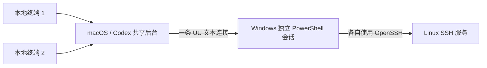

# uu-headless-ssh

让 Codex 或其他命令行工具通过 **UU → Windows → SSH → Linux** 操作远端设备，全程使用文本协议和本地 PTY。

Headless SSH access through a UU Remote Windows terminal, with a macOS controller.



SSH 实际由 Windows 设备发起。Windows 无需安装 SSH 服务端；Linux 无需安装额外 Agent。
入口不依赖截图、鼠标操作、键盘模拟或 UU 窗口。

## 运行条件

- macOS，已安装并登录网易 UU 远程。
- Python 3.9+、Swift / Xcode Command Line Tools、Rust / Cargo、Git。
- UU 中的 Windows 设备在线，并能打开自己的 PowerShell 文本终端。
- Windows 已安装 OpenSSH 客户端，能访问 Linux 的 SSH 地址。
- Windows 已配置 Linux 的 SSH 认证与可信主机密钥。

连接使用 `BatchMode=yes` 与 `StrictHostKeyChecking=yes`。密码提示和未知主机密钥会导致连接失败，需要先在 Windows 上完成相应配置。

## 快速开始

```sh
git clone https://github.com/YanLien/uu-headless-ssh.git
cd uu-headless-ssh
python3 scripts/build.py
cp config.example.json config.json
```

编辑本地 `config.json`：

```json
{
  "uu_device_id": "YOUR_UU_DEVICE_ID",
  "ssh_host": "192.0.2.10",
  "ssh_user": "linuxuser",
  "ssh_port": 22
}
```

设备 ID 可以用 UU 自带 CLI 查询：

```sh
/Applications/UURemote.app/Contents/Helpers/uuyc-cli device list --json
```

验证整条链路：

```sh
python3 connect.py --check
```

检查会在 Windows 上运行 SSH，再在 Linux 执行 `hostname`、`id -un`、`uname -s`。
成功时返回包含 `ok: true`、实际主机名、用户、系统以及 `ssh_exit_code: 0` 的 JSON，并退出本次测试会话。

进入 Linux 的交互式终端：

```sh
python3 connect.py
```

Codex 使用带 PTY 的命令工具启动交互模式，然后通过该工具的 stdin 发送 Linux 命令即可。
默认入口新建的远端终端归本次任务所有。在 Linux 中输入 `exit` 后，桥接程序也会结束本次 PowerShell，再清理新建的会话。按 `Ctrl+]` 或关闭本地窗口也会触发清理。
正常断开会等待远端清理确认；窗口直接关闭时，后台检测到本地连接结束后执行同样的清理。
连接中断时通过仍可用的通道尝试清理；共享连接失效后不会自动反复加入房间，以免挤掉官方客户端新建立的连接。
设备离线或网络不可达时无法保证立即删除，程序会报告未完成的清理和已确认的会话 ID。
Linux 的 zsh 可能把整段输入当作粘贴；命令停留在输入行时，再单独发送一次回车。
桥接入口会跟随本地终端的窗口尺寸，调整 Ghostty 大小时会更新远端终端。

在项目目录中执行，直接从 Ghostty 等本地终端进入 Windows PowerShell：

```sh
python3 scripts/terminal.py
```

此入口停留在 Windows。输入 `exit` 正常结束远端 PowerShell；`Ctrl+]` 只作为本地断开键，不发送给远端 shell。

查看现有会话，不创建 PowerShell：

```sh
python3 scripts/terminal.py --list
```

用输出中的 `session_id` 接入已有会话：

```sh
python3 scripts/terminal.py --session SESSION_ID
```

接入已有会话后，断开时只分离连接，保留会话。需要保留正在运行的程序时，关闭本地窗口或用 `Ctrl+]` 断开；输入 `exit` 会由远端 shell 自身结束程序。
结束选中的会话及其中的程序：`python3 scripts/terminal.py --kill SESSION_ID...`。
自动清理只删除能确认由本次调用新建的会话，不会清空其他会话。首次清单无法唯一识别新会话，或读取被中断时，会报错并保留归属不明的会话；不会用后续清单重新猜测归属。
如果另一端接入了本次任务新建的会话，结束创建它的任务仍会结束该会话。

## 多终端与官方客户端

在多个 Ghostty 窗口运行同一个入口即可。每个窗口拥有独立终端会话，多个窗口、会话清单与结束命令共享同一条后台 UU 连接。
当前实测范围是同一台 Windows 上的多会话；不同设备并行连接未验证。
启动锁保证同时打开多个窗口也只创建一个后台进程；新建会话在后台串行执行，之后各自传输输入输出。关闭一个窗口只清理它自己的新会话。
最后一个本地客户端离开后，后台空闲约 10 秒自动结束。已有客户端仍在线时保持运行，不安装开机启动项或修改官方 UU 服务。

旧的 `uuremote-viewer terminal DEVICE [SESSION]`、`terminal-list DEVICE` 和 `terminal-kill DEVICE SESSION...` 命令会自动转到共享入口，继续支持原来的 Swift 启动方式。

**多终端与官方桌面并用有区别。** 实测为同一登录身份另开独立信令连接会释放前一条连接，因此默认入口不再为每个窗口单独连接 UU。
官方 UU 已有远控连接时，程序不会再启动新的独立后台连接；这是保守保护，目前会阻止在官方连接期间首次启动后台，包括官方正在连接其他设备的情况。
同设备的官方桌面和本工具同时在线尚未验证为可共存，不能据此保证两者互不影响。
工具只读取已有登录配置，运行独立进程；本地 IPC 位于当前用户专有目录，仅传递终端消息，不传递登录令牌。

遇到 `cleanup unconfirmed` 或 `cleanup pending` 时，保留错误中的会话 ID，之后用清单和 `--kill` 核对。
不要用 `2>&1 | tee ...` 保存交互式终端，以免将远端内容一并写入日志。
旧版主机若仅返回会话编号 0，程序会拒绝开启第二个本地终端，以免输出混到一起。

## 实现

1. Python 启动器复用当前设备的后台连接；首次启动时，Swift 在内存中恢复已有 UU 登录上下文。
2. 后台纯文本客户端通过 UU API、信令与 WebRTC 数据通道，连接 Windows 的远程终端协议。
3. 各本地终端通过用户专有 Unix socket 接入后台，按独立会话编号转发输入输出。
4. Linux 入口另创建本地 PTY，检测 PowerShell 提示符，再自动输入由 Windows 发起的 SSH 命令。

凭据仅通过子进程环境传递，不生成第二份令牌文件。启动器不会修改官方 UU 登录配置。
仅在本人账号或明确获授权的设备上使用此工具。

## 代码与构建

| 文件 | 作用 |
| --- | --- |
| `connect.py` | PTY 转发、自动 SSH、链路检查 |
| `scripts/terminal.py` | 多终端入口、后台启动锁、会话管理 |
| `scripts/credentials.swift` | 复用本机当前用户的 UU 登录 |
| `scripts/build.py` | 拉取固定上游提交、应用补丁、编译客户端 |
| `UPSTREAM.txt` | 上游来源与固定提交 |
| `macos-headless.patch` | macOS 兼容、共享连接与会话清理补丁 |
| `config.example.json` | 可提交的配置模板 |

协议客户端来自 [VallierDev/uu-remote-linux](https://github.com/VallierDev/uu-remote-linux)，按固定提交构建。
补丁处理 macOS 登录中允许为空的 `system_id`、`/dev/tty` 输入兼容、CONTROL 保活、取消读取/写入时保留信令、完整处理握手消息，以及共享连接和任务会话的自动清理。
信令按官方 `RefreshSignalTokenLoop` 的节奏请求 `refresh_reconnect_key`：首次及失败重试间隔 30 秒，成功后间隔 300 秒。返回凭据不写入磁盘或日志。
Swift 启动器通过 `execv` 保持前台终端进程组，避免交互客户端被系统挂起。

`config.json`、编译产物、构建目录和日志均由 `.gitignore` 排除。
仓库不分发网易二进制文件；`bin/uuremote-viewer` 在本地从开源源码构建。
更新后运行 `python3 scripts/build.py`。构建器可以将已知旧补丁升级到新版本，并保留不冲突的本地修改；遇到未知或冲突修改时停止并保留构建目录。

可选优化构建：

```sh
python3 scripts/build.py --release
```

## 验证与限制

已在 macOS + UU 4.46.0 → Windows / OpenSSH 9.5 → Ubuntu 24.04 的真实链路验证 SSH 和交互式终端。
2026-11-14 实机验证了两路独立终端的变量与输出隔离、管理查询不中断、关闭一路后另一路继续响应、`Ctrl+]` 与 SIGTERM 退出清理，以及两路经 Windows 发起的 SSH 检查。测试结束后原有会话均保留，测试会话无残留。
新增本地回归覆盖共享启动锁、已有会话分离、异常取消后保留清理责任、旧主机会话编号保护、目录权限、空闲退出、握手处理不中断，以及 PTY 存活和窗口尺寸同步。
本地模拟验证不代表长时间实机连接已通过；信令房间仍可能由服务端主动关闭。

上游回归测试命令（在 `.build/upstream` 中运行）：

```sh
cargo test --locked --features native-viewer --bin uuremote-viewer auth::
cargo test --locked --features native-viewer --bin uuremote-viewer viewer::tools::
cargo test --locked --features native-viewer --bin uuremote-viewer viewer::tests:: -- --test-threads=1
cargo test --locked --features native-viewer --bin uuremote-viewer viewer::signal::tests:: -- --test-threads=1
```

本仓库的本地进程退出测试：`python3 -m unittest discover -s tests -v`。

这是第三方协议兼容实现，与网易无关联。当前凭据读取针对已验证的 macOS UU 版本；UU 更新后需要重新验证。
`--check` 输出简短身份信息，交互模式传递终端控制序列；本工具没有实现任意长输出的结构化远程执行接口。

## 许可证

GPL-3.0，见 [LICENSE](LICENSE)。上游源码与补丁来源记录于 `UPSTREAM.txt`。
