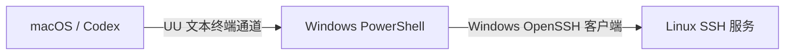

# uu-headless-ssh

让 Codex 或其他命令行工具通过 **UU → Windows → SSH → Linux** 操作远端设备，全程使用文本协议和本地 PTY。

Headless SSH access through a UU Remote Windows terminal, with a macOS controller.



SSH 实际由 Windows 设备发起。Windows 无需安装 SSH 服务端；Linux 无需安装额外 Agent。
入口不依赖截图、鼠标操作、键盘模拟或 UU 窗口。

## 运行条件

- macOS，已安装并登录网易 UU 远程。
- Python 3.9+、Swift / Xcode Command Line Tools、Rust / Cargo、Git。
- UU 中的 Windows 设备在线，并能打开自己的 PowerShell 文本终端。
- Windows 已安装 OpenSSH 客户端，能访问 Linux 的 SSH 地址。
- Windows 已配置 Linux 的 SSH 认证与可信主机密钥。

连接使用 `BatchMode=yes` 与 `StrictHostKeyChecking=yes`。密码提示和未知主机密钥会导致连接失败，需要先在 Windows 上完成相应配置。

## 快速开始

```sh
git clone https://github.com/YanLien/uu-headless-ssh.git
cd uu-headless-ssh
python3 scripts/build.py
cp config.example.json config.json
```

编辑本地 `config.json`：

```json
{
  "uu_device_id": "YOUR_UU_DEVICE_ID",
  "ssh_host": "192.0.2.10",
  "ssh_user": "linuxuser",
  "ssh_port": 22
}
```

设备 ID 可以用 UU 自带 CLI 查询：

```sh
/Applications/UURemote.app/Contents/Helpers/uuyc-cli device list --json
```

验证整条链路：

```sh
python3 connect.py --check
```

检查会在 Windows 上运行 SSH，再在 Linux 执行 `hostname`、`id -un`、`uname -s`。
成功时返回包含 `ok: true`、实际主机名、用户、系统以及 `ssh_exit_code: 0` 的 JSON，并退出本次测试会话。

进入 Linux 的交互式终端：

```sh
python3 connect.py
```

Codex 使用带 PTY 的命令工具启动交互模式，然后通过该工具的 stdin 发送 Linux 命令即可。
默认入口新建的远端终端归本次任务所有。在 Linux 中输入 `exit` 后，桥接程序也会结束本次 PowerShell，再清理新建的会话。按 `Ctrl+]` 或关闭本地窗口也会触发清理。
连接中断时也会尝试清理；原连接不可用时，只建立管理连接删除已确认的会话，不会另开 PowerShell。
设备离线或网络不可达时无法保证立即删除，程序会报告未完成的清理和已确认的会话 ID。
Linux 的 zsh 可能把整段输入当作粘贴；命令停留在输入行时，再单独发送一次回车。
桥接入口会跟随本地终端的窗口尺寸，调整 Ghostty 大小时会更新远端终端。

直接在 Ghostty 等本地终端进入 Windows PowerShell：

```sh
cd ~/uu-headless
uu_device_id=$(python3 -c 'import json; print(json.load(open("config.json"))["uu_device_id"])')
swift scripts/credentials.swift "$PWD/bin/uuremote-viewer" terminal "$uu_device_id"
```

此入口停留在 Windows。输入 `exit` 正常结束远端 PowerShell；`Ctrl+]` 只作为本地断开键，不发送给远端 shell。

查看现有会话，不创建 PowerShell：

```sh
swift scripts/credentials.swift "$PWD/bin/uuremote-viewer" terminal-list "$uu_device_id"
```

用输出中的 `session_id` 接入已有会话：

```sh
swift scripts/credentials.swift "$PWD/bin/uuremote-viewer" terminal "$uu_device_id" SESSION_ID
```

接入已有会话后，断开时只分离连接，保留会话。需要保留正在运行的程序时，关闭本地窗口或用 `Ctrl+]` 断开；输入 `exit` 会由远端 shell 自身结束程序。
终端管理命令还支持 `terminal-kill DEVICE SESSION_ID...`，用于明确结束选中的会话及其中的程序。
自动清理只删除能确认由本次调用新建的会话，不会清空其他会话。首次清单无法唯一识别新会话，或读取被中断时，会报错并保留归属不明的会话；不会用后续清单重新猜测归属。

如连接意外结束，可在上面的 `swift` 命令前加 `UU_TERMINAL_DIAGNOSTICS=1`：

```sh
UU_TERMINAL_DIAGNOSTICS=1 swift scripts/credentials.swift \
  "$PWD/bin/uuremote-viewer" terminal "$uu_device_id"
```

诊断只启用信令模块的事件名、结构和状态，不记录终端输入、输出或凭据。
不要用 `2>&1 | tee ...` 保存交互式终端，以免将远端内容一并写入日志。
请保留连接结束时的错误文字；`Remote session released` 表示收到匹配的释放通知，
`Signaling room closed` / `Signaling disconnected` 表示信令房间或传输结束。

## 实现

1. Swift 启动器在本机内存中恢复当前用户已有的 UU 登录上下文，使用登录令牌中的客户端与设备标识。
2. 纯文本客户端通过 UU API、信令与 WebRTC 数据通道，连接 Windows 的远程终端协议。
3. Python 创建本地 PTY，检测 PowerShell 提示符并自动输入到 Linux 的 SSH 命令。
4. 后续 stdin/stdout 经同一条 UU 文本通道传输。

凭据仅通过子进程环境传递，不生成第二份令牌文件。启动器不会修改官方 UU 登录配置。
仅在本人账号或明确获授权的设备上使用此工具。

## 代码与构建

| 文件 | 作用 |
| --- | --- |
| `connect.py` | PTY 转发、自动 SSH、链路检查 |
| `scripts/credentials.swift` | 复用本机当前用户的 UU 登录 |
| `scripts/build.py` | 拉取固定上游提交、应用补丁、编译客户端 |
| `UPSTREAM.txt` | 上游来源与固定提交 |
| `macos-headless.patch` | macOS 兼容与工具连接保活补丁 |
| `config.example.json` | 可提交的配置模板 |

协议客户端来自 [VallierDev/uu-remote-linux](https://github.com/VallierDev/uu-remote-linux)，按固定提交构建。
补丁处理 macOS 登录中允许为空的 `system_id`、`/dev/tty` 输入兼容、CONTROL 保活、取消读取/写入时保留信令，以及任务会话的自动清理。
信令按官方 `RefreshSignalTokenLoop` 的节奏请求 `refresh_reconnect_key`：首次及失败重试间隔 30 秒，成功后间隔 300 秒。返回凭据不写入磁盘或日志。
Swift 启动器通过 `execv` 保持前台终端进程组，避免交互客户端被系统挂起。

`config.json`、编译产物、构建目录和日志均由 `.gitignore` 排除。
仓库不分发网易二进制文件；`bin/uuremote-viewer` 在本地从开源源码构建。

可选优化构建：

```sh
python3 scripts/build.py --release
```

## 验证与限制

已在 macOS + UU 4.46.0 → Windows / OpenSSH 9.5 → Ubuntu 24.04 的真实链路验证 SSH 和交互式终端。
适配时运行了上游认证与终端/转发测试。新增本地回归覆盖房间续期、读写取消、任务结束删除、已有会话分离、归属不明时禁止重试、断开键不转发，以及 Python 在清理完成前保持 PTY 存活和窗口尺寸同步。
本地模拟验证不代表长时间实机连接已通过；信令房间仍可能由服务端主动关闭。

上游回归测试命令（在 `.build/upstream` 中运行）：

```sh
cargo test --locked --features native-viewer --bin uuremote-viewer auth::
cargo test --locked --features native-viewer --bin uuremote-viewer viewer::tools::tests::
cargo test --locked --features native-viewer --bin uuremote-viewer viewer::tests:: -- --test-threads=1
cargo test --locked --features native-viewer --bin uuremote-viewer viewer::signal::tests:: -- --test-threads=1
```

本仓库的本地进程退出测试：`python3 -m unittest discover -s tests -v`。

这是第三方协议兼容实现，与网易无关联。当前凭据读取针对已验证的 macOS UU 版本；UU 更新后需要重新验证。
`--check` 输出简短身份信息，交互模式传递终端控制序列；本工具没有实现任意长输出的结构化远程执行接口。

## 许可证

GPL-3.0，见 [LICENSE](LICENSE)。上游源码与补丁来源记录于 `UPSTREAM.txt`。
